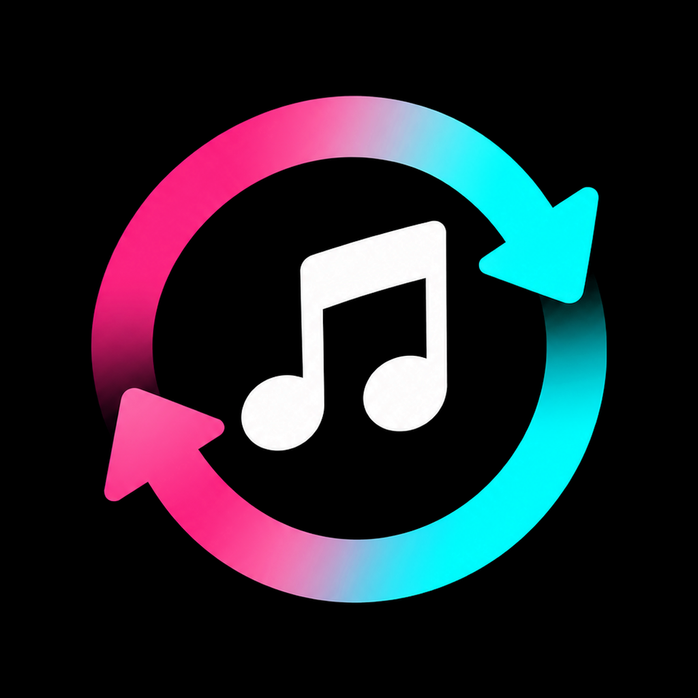

<div align="center">



# Tok Music

**Loop your favorite TikTok sounds — offline, in the background, without the video.**

Share a TikTok to the app → name it → pick a playlist → it downloads and starts looping.
No server, no account: everything happens on your phone.


</div>

---

## ✨ Features

- **Share from TikTok** — no copying links. Share → More → **Tok Music**.
- **"Contains" detection** — when a sound is an *original sound* that TikTok says contains a song,
  Tok Music finds that song (title & artist) and suggests it as the name.
- **Name before download** — a details screen lets you rename the sound, set the artist and choose playlists.
- **Playlists** — create, rename, delete; add or remove sounds anytime from the ⋯ menu.
- **Loop one / play playlist** — one tap switches between endlessly repeating a single sound and playing the whole list.
- **Background & lock screen playback** — keeps playing with the screen off, with lock-screen controls.
- **Offline library** — audio and covers are stored on the device, so they keep working after TikTok links expire.
- **Onboarding** — a short walkthrough on first launch (reopen anytime with the **?** button).

## 📱 How to use

1. Open a video in **TikTok**.
2. Tap **Share** → **More / Other apps** → **Tok Music**.
3. Check the name (the "Contains" song is pre-filled if there is one) and pick playlists.
4. Tap **Download & play** — the sound starts looping right away.

## 🧩 How it works

| File | What it does |
| --- | --- |
| `src/tiktok.ts` | Finds the TikTok link in shared text, expands short links, reads the sound from the TikTok page's embedded JSON (falls back to the public tikwm.com API). Looks up the **Contains** song via TikTok's Apple Music / Spotify ids (iTunes lookup, Spotify oEmbed). |
| `src/library.ts` | Downloads audio + cover into `Documents/sounds/`, persists tracks, playlists and onboarding state in AsyncStorage. |
| `src/store.tsx` | App state and the `expo-audio` player: queue, loop-one / playlist modes, share → details → download flow. |
| `src/AddSoundModal.tsx` | The pre-download screen (name, artist, playlists, Contains). |
| `src/Onboarding.tsx` | First-launch walkthrough. |
| `src/ui.tsx` | Theme, bottom sheets, name prompt, confirm dialog, chips. |
| `App.tsx` | Main screen: playlist bar, track list, player bar. |

## 🛠️ Development

The share menu needs native code, so the app **does not run in Expo Go** — use a development build.

```bash
npm install
npx expo start          # with a development build installed on the phone
```

**Android, locally** (USB debugging on):

```bash
npx expo run:android
```

**Android, in the cloud (EAS):**

```bash
npx eas-cli@latest build -p android --profile development   # dev client
npx eas-cli@latest build -p android --profile preview       # installable APK
```

On macOS you can also just double-click **`build-android.command`** — it installs dependencies and starts the preview APK build.

**iOS:** requires Xcode — `npx expo run:ios --device`.
The iOS share extension uses App Groups, which needs a paid Apple Developer account.

### Checks

```bash
npx tsc --noEmit
npx expo lint
```

## 🎨 Assets

`assets/logo-source.png` is the original logo. App icon, Android adaptive/monochrome icons, splash and favicon are generated from it.

## ⚠️ Disclaimer

Tok Music is a personal project and is not affiliated with TikTok or ByteDance.
Only save sounds you have the right to use, and respect artists' copyrights.
